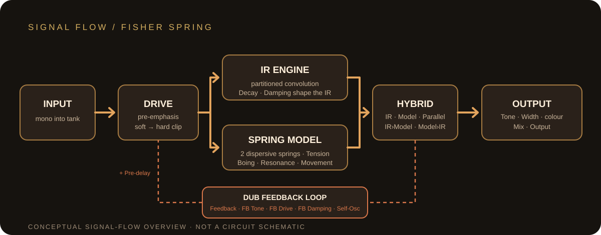
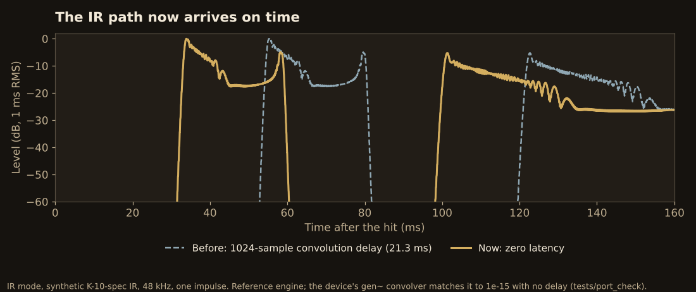

<div align="center">


</div>

<div align="center">

# Fisher Spring

**A hybrid spring reverb for Ableton Live.**

Zero-latency convolution with real spring tanks, a physical spring model voiced from the Fisher K-10 service manual, and analogue-style saturation.

[Features](#features) · [Install](#install) · [Controls](#controls) · [Presets](#presets) · [Validation](#validation-and-known-limitations) · [Developers](#developer-quick-reference)


[](https://github.com/Echolivity/fisher-spring/actions/workflows/tests.yml)

</div>

> **Status: not yet tested in Ableton Live.** The DSP is complete and passes its automated tests. The device's own gen~ and JavaScript code produce the same output as the tested reference engine when run outside Max. Nobody has opened it in Max or Live yet, and nobody has listened to it.
>
> **Fisher authenticity:** the physical model's timing and circuit filtering come from the K-10 service manual and the Sams Photofact schematic, and the tank's own response is fitted to a real K-10 IR (within 2.1 dB). The Fisher Reference IR is a third-party K-10 capture (Freesound #528139) whose timing and spectrum match that manual. This project has not captured hardware itself, and the third-party IR licences are **unconfirmed**, so don't redistribute them. See [`docs/FISHER_K10.md`](docs/FISHER_K10.md) and [`DEVELOPMENT_REGISTER.md`](DEVELOPMENT_REGISTER.md).

**Requirements:** Ableton Live 12 Suite, or Live 12 Standard with the Max for Live add-on.

## Features

- **Two engines in one tank:** partitioned convolution with spring IRs, and a physical model with two dispersive springs, coupled loops, a resonant mode, splash, collision and mechanical drift.
- **Five hybrid modes:** IR, Model, Parallel, IR›Model (the real tank feeds the model's sway) and Model›IR (the model excites the real tank).
- **K-10 voicing:** at the default Tension of 0.44, the model's spring arrivals match the service manual's 29 / 37 / 87 / 111 ms within 2 ms.
- **Drive** with pre-emphasis, so highs saturate first, moving from soft to hard clip.
- **Zero-latency convolution:** the IR path arrives on time, so spring arrivals keep their real timing and nothing needs delay compensation.
- **Open IR library:** 5 synthetic IRs included. Drop any WAV onto the device to use your own.
- **10 factory presets** across reference, dub, texture and percussion.

## Inside the sound




<sub>The model's impulse response. Every reflection is a downward chirp, the "pew" that makes a spring sound like a spring.</sub>



<sub>One hit through the IR engine. Until 27 Nov 2026 the convolution added 21 ms (dashed); it now adds none, so the tank's first arrival lands where the IR puts it.</sub>

<sub>Both plots are rendered from the Python reference engine by `tools/make_readme_plots.py`. They are simulations, not recordings of the device in Live.</sub>

This is a **character model voiced from published K-10 documentation, not a hardware clone**. It is not affiliated with or endorsed by Fisher or its successors; the name is used only to describe the historical reference.

## Install

1. Copy the whole repository folder somewhere permanent, for example `~/Music/Ableton/User Library/Echolivity/`. The device finds `ir/` relative to itself, so keep the folder structure.
2. In Live 12, drag [`device/Echolivity.amxd`](device/Echolivity.amxd) onto an audio track or a return track.
3. If Live won't open the `.amxd` or crashes, **save your work first** and run the diagnostic ladder (`python tools/make_bisect.py OUT`, then load the test devices from inside `device/`); the first one that crashes shows which part is responsible. The patch structure was aligned with what Max itself saves on 18 Nov 2026, after the same hand-built pattern crashed another Echolivity device. As a fallback, drop an empty *Max Audio Effect* on a track, open it in Max, open [`device/Echolivity.maxpat`](device/Echolivity.maxpat), copy everything into the device, and save. See [`docs/QA_PROTOCOL.md`](docs/QA_PROTOCOL.md), step 1.
4. Needs **Live 12 with Max 9** (the scripts are embedded with `v8.codebox`; no loose `.js` files). Before moving the device to another machine, you can still **Freeze** it in Max. The IR library still has to sit at `../ir/processed/` relative to the device, or you can drop WAVs onto the IR zone instead.

**Recommended use:** put it on a return track with Mix at 100 %, and send rimshots, snares, skanks and chords to it. For regeneration, feed it from a delay return (recipes in the workflow guide). More recipes are in [`docs/DUB_WORKFLOW.md`](docs/DUB_WORKFLOW.md).

## Controls

### Core
- **Drive:** input saturation into the tank driver. Highs saturate first (pre-emphasis). Above about 60% it moves from soft to a harder clip. It also adds even-harmonic colour at the output.
- **Decay:** the spring model's RT60, from 0.3 to 8 s. On the IR engine it can only *shorten* the IR from its natural length.
- **Tone:** ±6 dB tilt EQ on the wet signal, pivoting at 900 Hz.
- **Damping:** how much faster the highs decay than the lows, on both engines. The default, 0.8, matches the K-10.
- **Mix:** equal-power dry/wet.
- **Output:** output level, −24 to +6 dB.

### Spring
- **Boing:** how hard the spring reacts to transients: pitch sway, splash noise and collision clatter on hard hits.
- **Tension:** short, tight springs (high) versus long, slack springs (low). **0.44 is the Fisher K-10** (29 and 37 ms springs). It also moves the resonant mode.
- **Dispersion:** strength of the chirp, the characteristic "pew" of each spring reflection.
- **Resonance:** makes the spring's main mode ring while everything else decays faster.
- **Movement:** random mechanical instability: slow drift, stiffness wobble and occasional jolts.

### Hybrid
- **Engine Mode:**
  - *IR*: convolution only.
  - *Model*: physical model only.
  - *Parallel*: both, blended.
  - *IR>Model*: the real tank feeds the model, which adds sway and movement.
  - *Model>IR*: the model excites the real tank.
- **IR Level / Model Level:** the level of each engine.
- **Hybrid Blend:**
  - In Parallel, an equal-power crossfade from IR to Model.
  - In the serial modes, a crossfade from the first engine alone to the signal through both engines.

### Advanced
- **IR menu:** the library IRs (Fisher K-10 first, then other third-party tanks, then synthetic), plus *User IR*. Drop any mono or stereo WAV onto the zone below the menu. The device resamples it and caps it at 4 s.
- **Pre-delay:** 0 to 250 ms before both engines.
- **Width:** mid/side width of the wet signal, from 0 to 200%.
- **Modulation:** a slow periodic chorus on spring length. It's separate from Movement, which is random.

The **PRESET** menu loads the factory presets. The IR each preset expects is loaded with it. Live's own device presets (`.adv`) work as usual.

**Latency:** none on the dry, model or IR paths, so there is nothing to report to Live. The one exception is *Model>IR*, where the spring output reaches the convolver one Live audio buffer late (see the known limitations).

## Presets

| # | Preset | Category | IR | What it does |
|---|---|---|---|---|
| 1 | Fisher Reference | REF | Fisher K-10 † | The K-10 IR alone, natural decay |
| 2 | Vintage Splash | REF | Fender Deluxe † | Bright parallel hybrid: tank body with model boing and drip |
| 3 | Deep Dub Spring | DUB | Fisher K-10 † | Long, warm send spring |
| 4 | Metallic Resonance | TEX | Short Tank (synthetic) | Model-led singing metallic mode, tuned by Tension |
| 5 | Heavy Pressure | DUB | Dark Tank (synthetic) | Hard-driven tank: thick, compressed dub wall |
| 6 | Dark Chamber | REF | Dark Tank (synthetic) | Smooth, dark tank, like a small room |
| 7 | Long Dub Tail | DUB | Fisher K-10 † | 8-second parallel wash for throws |
| 8 | Broken Spring | TEX | Splash Tank (synthetic) | Jolts, pitch lurches and clatter |
| 9 | Short Percussion Spring | PERC | 70s Stereo Spring † | Short, tight and bright, for hats and percussion |
| 10 | Experimental Mechanical | TEX | Dark Tank (synthetic) | Model›IR, high resonance: grinding textures |

<sub>† Third-party IR, not included in this repository because its licence is unconfirmed. These presets need the IR added locally; see [`ir/originals/third_party/README.md`](ir/originals/third_party/README.md).</sub>

## Validation and known limitations

| Area | State |
|---|---|
| Reference engine | Technically validated: convolution exactness, decay, damping, sample rates, denormals, long-duration stability, presets |
| Device code (gen~ and js) | Matches the reference outside Max (correlation 0.99999, convolution error ~1e-15) |
| Max / Live | **Owner-tested in Live 12 on 28 Nov 2026:** loads, IR mode plays without crackle at buffers 256 and 128, IR path in time with the dry signal (no gap), all five engine modes and an IR change while playing, all 10 presets, CPU with one and two instances. Still open: the rest of `docs/QA_PROTOCOL.md` (automation, long runs, sample-rate switching) |
| Fisher authenticity | Timing and spectrum match the manual and a third-party K-10 IR; no capture of our own yet |
| Musical validation | **Not done**: no listening tests yet |

Main limitations:
- IRs are capped at 4 s.
- Decay can only shorten an IR.
- Model>IR mode delays the spring→IR send by one Live audio buffer.
- The third-party IR licences are unconfirmed.

Full lists: [`KNOWN_LIMITATIONS.md`](KNOWN_LIMITATIONS.md) · [`DEVELOPMENT_REGISTER.md`](DEVELOPMENT_REGISTER.md) · [`reports/TECHNICAL_VALIDATION.md`](reports/TECHNICAL_VALIDATION.md) · [`docs/QA_PROTOCOL.md`](docs/QA_PROTOCOL.md).

## Developer quick reference

```bash
pip install numpy scipy numba soundfile pytest
python tools/synth_ir.py          # regenerate synthetic IRs
python tools/ir_catalogue.py      # processed IRs + catalogue + audit
python tools/build_presets.py     # presets/*.json
python tools/build_device.py      # device/Echolivity.maxpat + .amxd
python tests/validate.py          # technical validation (~15 min)
python tests/port_check/check_conv_port.py && python tests/port_check/check_gen_port.py
python tools/make_report.py       # reports/TECHNICAL_VALIDATION.md
python tools/render_demos.py      # renders/
python tools/make_readme_plots.py # the plots on this page (needs matplotlib)
```

Design rule: change DSP in `reference/engine.py` first, port it to `device/gen/*.genexpr`, then run the port checks.

## Project map

| Path | What it is |
|---|---|
| `device/Echolivity.amxd` | The Max for Live device. Keep the folder structure; it finds `ir/` relative to itself. |
| `device/Echolivity.maxpat` | The same patch, for opening in Max directly. |
| `device/gen/*.genexpr` | The DSP code inside the device's three gen~ objects (front, convolution, back). |
| `device/code/ech_ir_loader.js`, `device/code/ech_ui.js` | Source of the IR loader and IR browser. The build embeds them in the device (`v8.codebox`). |
| `reference/` | Reference DSP engine (Python + numba). The specification the device is ported from. |
| `ir/` | IR library: `originals/` (never modified), `processed/` (what the device loads), `CATALOGUE.md`. **This repository holds only the 5 synthetic IRs.** The third-party IRs (including the Fisher K-10) aren't published because their licenses are unconfirmed; their provenance records are here, and `ir/originals/third_party/README.md` says how to add the audio locally. |
| `presets/` | 10 factory presets as JSON plus `index.json`. They're also built into the device's preset menu. |
| `renders/` | Not in the repository. Generate with `python tools/render_demos.py` (needs the third-party IRs). |
| `tests/` | Automated validation suite and the Max port checks. |
| `tools/` | Builders (device, presets, IR catalogue, synthetic IRs), report generator and a Live-vs-reference comparison tool. |
| `docs/` | DSP architecture, IR capture procedure, Live QA protocol, dub workflow and routing, preset standards. |
| `reports/` | Technical validation report, musical validation protocol, production usability report. |
| `assets/`, `docs/img/` | Images on this page. |
| `DEVELOPMENT_REGISTER.md` | Status, owner and evidence for every feature. |
| `KNOWN_LIMITATIONS.md` | What doesn't work or hasn't been proven yet. |

---

<div align="center">

**ECHOLIVITY TOOLS** · Sound first. Engineering second. Hype last.

</div>

## License

MIT, see [LICENSE](LICENSE). This covers the code, the device and the synthetic IRs. Third-party IRs and reference documents are not in this repository and are not covered (see `ir/originals/third_party/README.md`).
